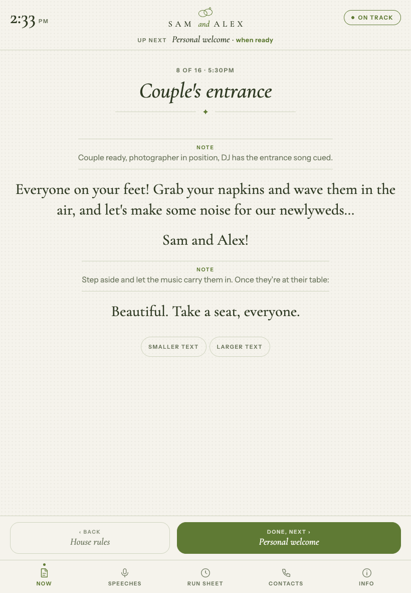
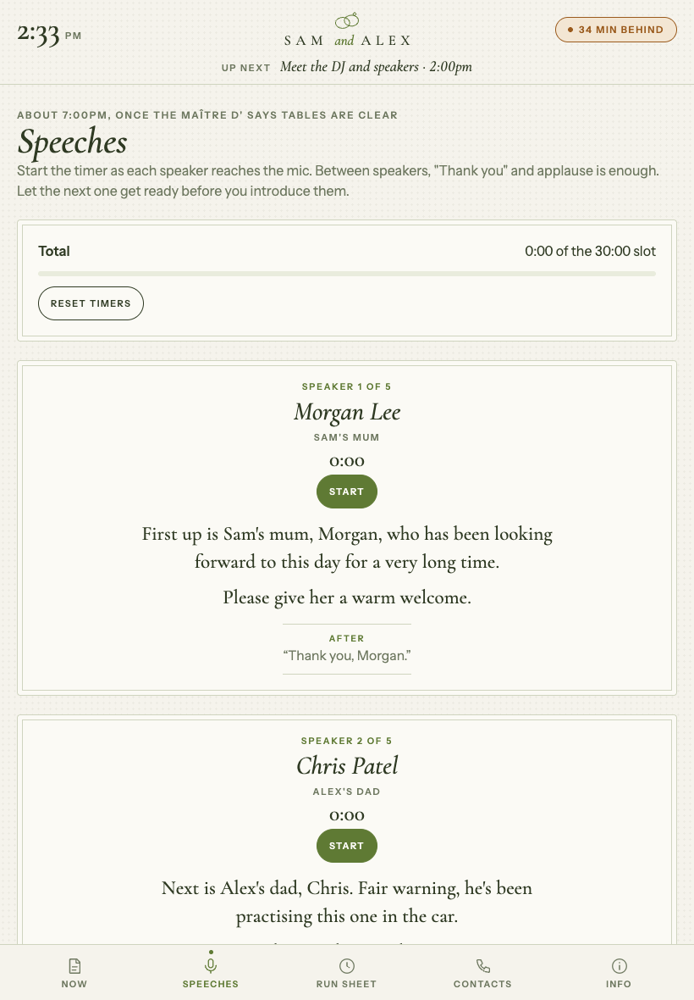
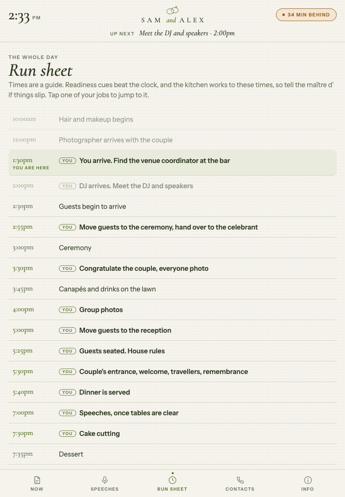

# Wedding MC app

A single-page app that turns your MC notes into an iPad teleprompter for the night. It holds your script, the run sheet, speaker intros with timers, photo groups, contacts and house rules, and tells you at a glance whether you're on time.

I built it to MC a friend's wedding and it made the night much easier, so here it is for anyone else who's been handed the microphone. Everything in this repo is example content for a made-up couple, Sam and Alex. Swap in your own.

**Try the demo:** https://adam1194.github.io/wedding-mc-app/

  
  
  

## What it does

- **Now.** Your current job's script in large type, with your notes to yourself between thin rules. Tap "Done, next" to move on and Back to go back. The app never jumps ahead on its own, because weddings never run perfectly to time.
- **Timing.** The header shows the clock, what's up next and how long until it's due. A pill reads "On track", or turns amber with "12 min behind" once the next job is five minutes overdue. If you fall well behind, a "Skip to…" button appears. Jobs that start on a cue (the first dance, the welcome) are marked "When ready" and never count you as late.
- **Speeches.** Every speaker with your intro for them, a stopwatch each, and a running total against the speech slot.
- **Run sheet.** The whole day, with your jobs marked and "You are here" highlighted. Tap any of your jobs to jump to it.
- **Photo groups.** A numbered list with a tick box, a notes field for names to gather, and up/down arrows to reorder.
- **Contacts.** Call and Copy buttons for the venue, DJ, photographer and the rest.
- **Info.** House rules, pronunciations, spare lines for awkward moments, things still to confirm, and a notes box.
- **Rehearsal clock.** Pretend it's any time of day and walk through the whole evening beforehand.
- **Dark mode** for a dim reception room, adjustable text size, and the screen stays awake while it's open.

It works on an iPad in portrait or landscape, and on phones and laptops too.

## Set it up for your wedding

Everything is in one file, `index.html`. Near the top is a block marked **YOUR WEDDING SETTINGS**. That's the only part you need to change.

1. Download `index.html` (or fork this repo).
2. Open it in any text editor and edit the settings block:
   - `couple`, `venue`, and who to tell when things slip (`venueLead`)
   - `schedule`: the whole day. Add `job: "<id>"` to the rows that are yours.
   - `jobs`: your jobs in order, each with its script
   - `speakers`, `contacts`, `photoGroups`
   - `info`: house rules, pronunciations, spare lines, things to confirm
   - `storageKey`: give each wedding its own, so ticks and notes from one don't carry over
3. Open the file in a browser to check it, then put it on your iPad (below).

### Writing the script

Each line of a job's `script` starts with one symbol:

| Symbol | Shows as | Example |
|---|---|---|
| `>` | A line you say, in large type | `>Please welcome Sam and Alex!` |
| `!` | A note to yourself, small and set apart | `!Wait for the photographer.` |
| `#` | A small sub-heading inside a job | `#After the photo` |
| `*` | A checklist item, for briefings | `*Confirm the entrance song` |
| `^` | A bold label above names | `^From Canada:\|Priya and Dev.` |

Times are 24-hour (`"17:30"`). Add `flex: true` to a job that starts on a cue rather than a set time.

## Getting it onto your iPad

Pick whichever suits you:

- **Netlify Drop (easiest).** Go to app.netlify.com/drop and drag `index.html` in. You get a private, hard-to-guess link to open on the iPad.
- **GitHub Pages.** Fork this repo, edit `index.html`, then turn on Pages under Settings → Pages. Your site will be public, so read the privacy note below first.
- **Claude.** Paste your edited file into Claude and ask it to publish it as an artifact.

Then in Safari on the iPad, tap Share → **Add to Home Screen** so it opens full screen like an app.

## On the day

- Open it on the iPad you'll actually use, a day or two before. Ticks, notes, photo-group names and speech timers are saved in that browser only.
- Rehearse with the clock under Info, then tap **Back to the first job** so it starts at the right place.
- Make sure you'll have signal or Wi-Fi. The page needs a connection to load.
- If the screen still dims, set Auto-Lock to Never for the night.
- Charge the iPad and bring a charger.

## Privacy

Nothing leaves the device. There's no server, no tracking and no account. Your progress is stored in the browser's local storage on that iPad.

Your copy of the file will contain real names, phone numbers and personal stories. If you host it on a public site such as GitHub Pages, anyone with the link can read it. Keep your real version somewhere private, or use an unlisted link.

## Licence

MIT. Use it, change it, share it.
